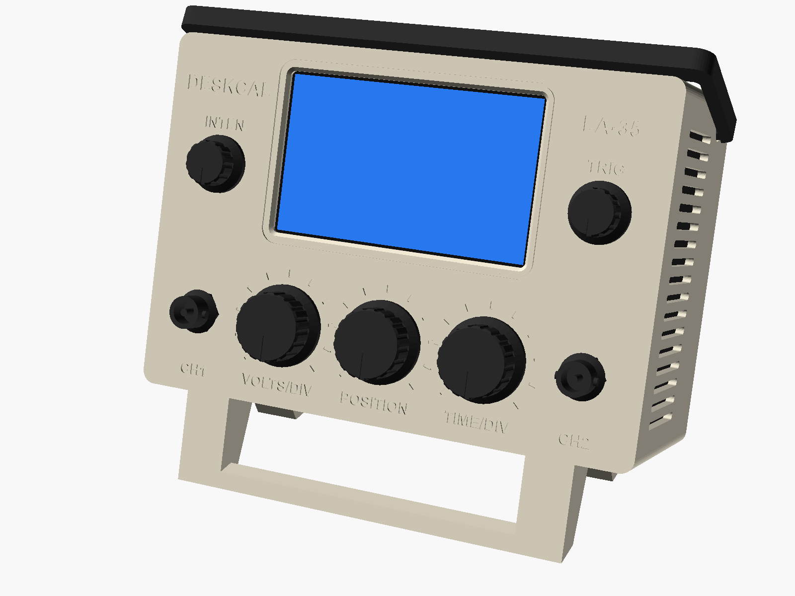
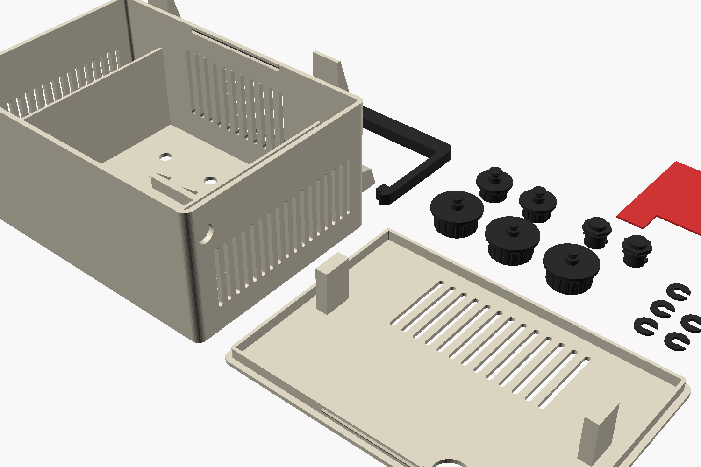
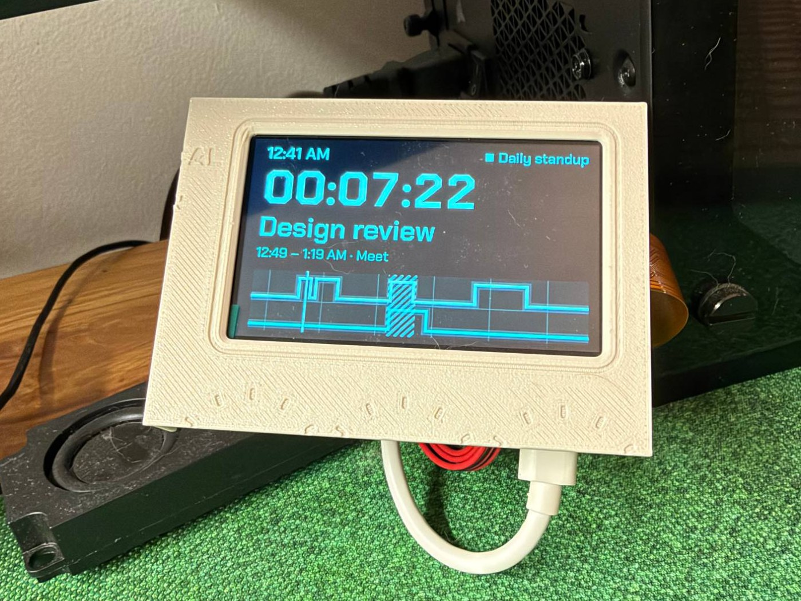
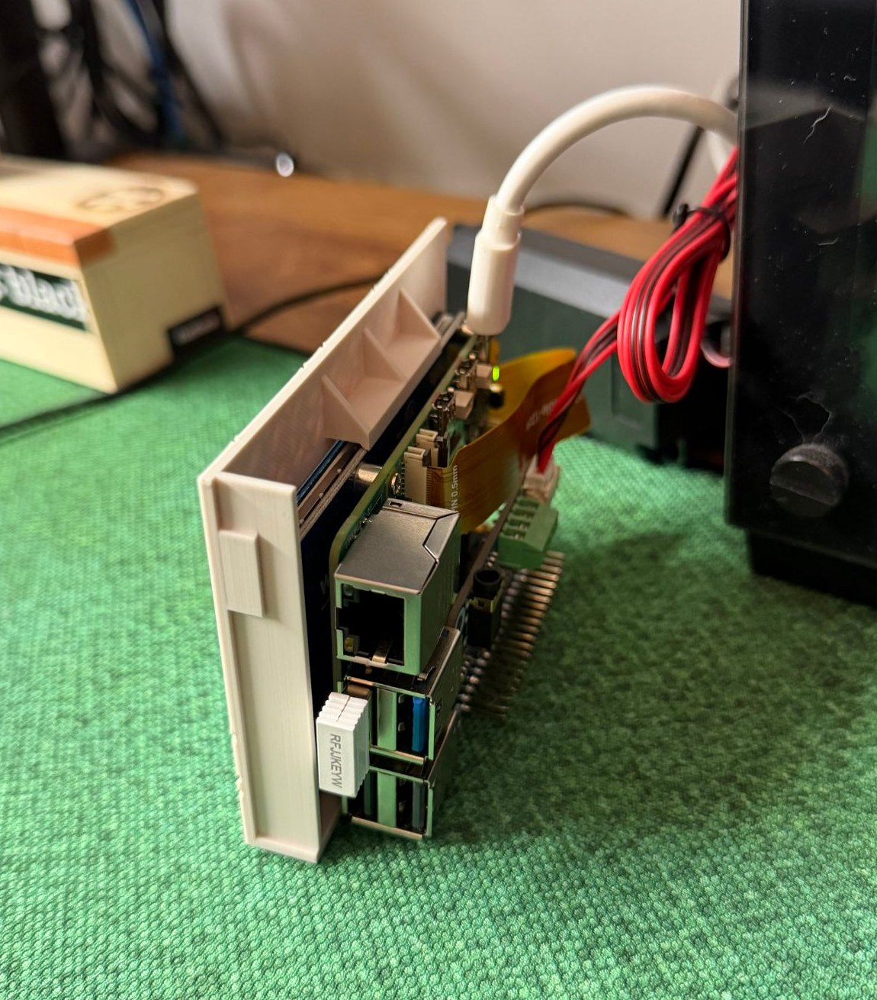

# Stand

A 3D-printed mini oscilloscope that the Pi, screen, audio HAT and speakers slot into.

It is 152 mm wide, 106 mm tall and 68 mm deep before the knobs and feet, and leans the screen back 18°. The speakers stand on end behind the side vents, the knobs spin, and the handle folds flat along the top. Nothing is screwed or glued except the two dummy BNC jacks.

The model is built for this hardware:

- Raspberry Pi 5 mounted on the back of a Waveshare 3.5inch DSI LCD (H)
- WM8960 Audio HAT on the GPIO header
- the pair of 8 Ω 5 W box speakers that ships with the HAT

Dimensions come from Waveshare's drawings. The screen mount has been checked with a printed fit test; the rest of the case, including the speaker bays, has not been printed yet.

## Parts

`./build.sh` writes these to `stl/`, already turned the right way up for the bed.

| File | Qty | Notes |
|---|---|---|
| `fit_test.stl` | 1 | The section of the case that holds the screen. Print this first. |
| `body.stl` | 1 | Prints on its front face. |
| `back.stl` | 1 | |
| `handle.stl` | 1 | Accent colour |
| `knob_big.stl` | 3 | Accent colour |
| `knob_small.stl` | 2 | Accent colour |
| `clip.stl` | 5 | One per knob |
| `bnc.stl` | 2 | Accent colour |
| `lock.stl` | 1 | Optional |

Print everything at 0.2 mm layers with no supports. PLA is fine; all of it comes to about 250 g. A textured plate gives the front panel a good finish.

## Before you print the case

1. Measure a speaker. The model assumes 100 mm long including the mounting ears and 21 mm thick. If yours differ, change `spk_len` and `spk_t` at the top of `deskcal_stand.scad`.
2. Check that the gap between the display board and the Pi is at least 3 mm. The two retaining lips sit in that gap.
3. Print `fit_test.stl` and try the screen in it, following step 2 of the assembly below. The display board should drop onto the shelf with a little play, and should not pull straight back out.

  
  

If the fit is off, these are the settings to change:

| Symptom | Setting |
|---|---|
| Display board won't go behind the lips | raise `lip_gap`, or `disp_t` if the stack is thicker than 5.7 mm |
| Display rattles front to back | lower `lip_gap` |
| Can't lift the board over the shelf lip | raise `top_clear` |
| A lip hits a part on the back of the board | narrow `shelf_x` or `toplip_x` |

## Assembly

1. Push each knob through the front and slide a clip into the groove on its shaft from inside. Press the BNC jacks in with a dab of glue.
2. Unplug anything in the USB-A ports: the left speaker bay sits right beside them. Hold the Pi and screen with the USB-C port facing down and the USB-A ports on the left, seen from the front. Angle the top edge in under the roof, swing the bottom in against the front panel, and let it drop onto the shelf.
3. Optionally slide `lock.stl` in under the roof, above the Pi, so the screen can't be lifted back off the shelf.
4. Slide a speaker into each side bay, cone facing the vents, and plug them into the HAT.
5. Plug in power, lay the cable in the notch and press the back panel on until it clicks.
6. Spring the handle over the case so its pins drop into the two holes near the top rear corners.

With the USB-C port facing down the picture may be upside down. Flip it in *Screen Configuration → DSI → Orientation*; the touch input follows.

The Pi has no fan in here. There are vents in the floor, sides and back, but check `vcgencmd measure_temp` after an hour and leave the back panel off if it runs hot.

## Changing the design

Everything is driven by the values at the top of `deskcal_stand.scad`. Open it in OpenSCAD to see the assembled view, set `section_x` to cut it open, or set `part` to look at one piece. The panel lettering is in `face_engrave_2d()`.
